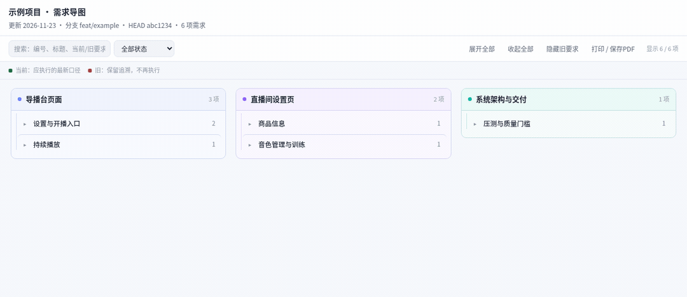

# 需求导图 · DSH 插件

**把项目需求变成一张可交互的思维导图：自动发现台账、后台生成、悬停即展开、解决个人coding或者大项目同个功能的需求一直变动时的记录，不同会话在同个项目也可整理，对应不同项目之间的思维导图。**

<sub>DSH (DeepSeek Harness) plugin that turns a project's requirement ledger into an interactive mind map — auto-discovery, background generation, hover preview, and inline status editing.</sub>



*悬停分组自动展开，悬停需求展开「当前要求 / 旧要求」对比，点击可钉住。*

---

## 它解决什么问题

需求散落在聊天记录、`README`、`CHANGELOG`、各种 `docs/*.md` 里，没人说得清「现在到底要做哪些、哪些已经变了口径」。

这个插件把**一份 JSON 台账**当成唯一事实来源，并在 DSH 里提供四个入口：

| 入口 | 位置 | 用途 |
|---|---|---|
| **右侧栏标签页** | 右侧栏「+」→ 需求导图 | 边写代码边看需求，可拖拽、可全屏 |
| **独立页面** | 左侧面板列表 → 需求导图 | 全屏浏览，切换项目/会话 |
| **文档预览** | 打开台账文件自动渲染 | 直接看某个台账 |
| **模型工具** | `requirement_map` | 让 agent 结构化维护台账 |

## 功能

- **自动发现**：扫描工作区，识别 `*.reqmap.json`、`需求台账*.json`、`requirements.json`、`docs/requirements/*.json`，并用 schema 校验排除无关 JSON。
- **项目即台账**：选择项目后只显示该项目内的台账；两个项目的产物不会互相覆盖。
- **后台生成**：点「生成需求导图」，插件在 Host 侧读取**你会话里提出的要求**（不是仓库 README），调用部署默认模型生成台账，**不产生会话轮次**。生成是按会话的后台任务，切换会话不中断，可随时暂停。
- **悬停即展开**：分组和需求都支持「悬停预览 + 点击钉住」，收起时内容不占 DOM，大台账也不卡。
- **状态可改**：点状态徽章直接改，写回台账文件并校验。
- **搜索与筛选**：按编号/标题/当前/旧要求/备注搜索，按 `meta.statuses` 筛选，含「优先看未闭环」。
- **旧口径留痕**：`current` 是当前口径，`old` 保留被替代的历史，不删记录。

## 安装

**从 GitHub 安装**（推荐）：

```bash
dsh plugin --profile web add github:Eeeeeend/dsh-plugin-requirement-map
```

**从本地目录安装**：在 DSH 的 **Plugins → Add plugin** 里选择本仓库目录，或

```bash
dsh plugin --profile web add link:/path/to/dsh-plugin-requirement-map
```

安装后重启 DSH（Host 侧代码变更需要重启才生效），在右侧栏「+」里即可看到「需求导图」。

## 快速开始

1. 打开右侧栏「+」→「需求导图」（或左侧面板列表里的「需求导图」）。
2. 顶部「项目」下拉选择要生成台账的项目。
3. 若该项目还没有台账，点「生成需求导图」；插件会读取当前会话中你提出的要求并生成。
4. 生成完成后导图自动出现，之后每次需求变更点「刷新」即可。

## 台账格式

唯一数据源是一个 JSON 文件：

```json
{
  "meta": {
    "title": "项目需求导图",
    "date": "2026-11-24",
    "branch": "feat/example",
    "head": "abc1234",
    "scope": "范围说明",
    "statuses": {
      "未完成": "已有明确未完成或失败证据",
      "部分完成": "已有实现，仍有未完成部分",
      "待核实": "需要补验收或核对交付",
      "暂缓": "当前不推进",
      "已上线": "有生效证据"
    },
    "roots": ["导播台页面", "系统架构与交付"]
  },
  "requirements": [
    {
      "id": "DB-01",
      "root": "导播台页面",
      "group": "展示位置",
      "title": "设置入口高亮",
      "current": "设置入口做成明显高亮按钮；打开设置期间置灰。",
      "old": "原文字入口不明显。",
      "status": "已上线",
      "source": "会话用户要求",
      "note": ""
    }
  ]
}
```

- `id` 唯一；`root` 属于 `meta.roots`；`status` 是 `meta.statuses` 的键。
- `statuses` 由你定义——插件不硬编码业务状态，界面下拉自动跟随。
- `old` 保留被替代口径；`note` 记录边界、待确认事项。

## 后台生成怎么工作

```
页面「生成需求导图」
  → POST /requirement-map/generate
  → Host 从会话日志取出你发的消息（source.kind === 'user'）
  → 调用部署默认模型（agentDefaultModel）
  → 校验并写入 <project>/docs/requirements/requirements.reqmap.json
  → 页面轮询状态，完成后自动刷新
```

- 不传 `sessionId` 给模型调用，避免污染会话日志。
- 生成任务按 **(会话, 项目)** 隔离，支持暂停。
- 仓库文档只作为兜底：会话里没有你的要求时才读文档。

## 交互

| 操作 | 效果 |
|---|---|
| 悬停分组 | 50ms 后展开预览 |
| 悬停需求 | 40ms 后展开「当前 / 旧」对比 |
| 点击分组或需求 | 钉住（移开不收起），再点取消 |
| 点状态徽章 | 下拉改状态，写回台账 |
| 展开全部 / 收起全部 | 批量控制 |
| 隐藏旧要求 | 只看当前口径 |
| 打印 / 保存 PDF | 自动展开全部，输出干净版式 |

## 模型工具

agent 可以直接维护台账：

```
requirement_map action=init      path=…            建立骨架
requirement_map action=add       path=… id=… …     新增一条
requirement_map action=update    path=… id=… …     改口径（旧口径进 old）
requirement_map action=search    path=… query=…    按关键词找
requirement_map action=show      path=… id=…       看完整字段
requirement_map action=validate  path=…            校验结构
requirement_map action=summary   path=…            统计
```

## 兼容性

- 在 DSH `0.2.2-rc.5`（Web profile）上开发并验证。
- 需要 `webServer`（后台生成的 HTTP 路由）与 `llm` 服务；缺少时生成会报明确错误，浏览与预览不受影响。
- 浅色/深色主题、窄屏单列、`prefers-reduced-motion` 均已适配。

## 隐私

- 插件**不持有任何凭据**；模型调用走 DSH 自己的 `llm` 服务。
- 不发送遥测。
- 生成时只把**本项目文档**或**你会话中的要求**发给模型；台账写入本地工作区。

## 已知限制

- 台账发现限于所选会话的工作区根目录；工作区外的台账需在文件树中打开。
- 文档预览入口是只读的（没有会话上下文可写入）。
- 生成质量取决于会话中需求的清晰度；生成后建议人工过一遍，`scope` 会标注「请人工复核」。
- 「展开全部」会一次性挂载所有内容，超大台账（500+ 项）可能短暂卡顿。

## 开发

```bash
# 本仓库即插件目录；Host 逻辑在 index.js / ledger.js / generate.js
# 浏览器逻辑在 client.js（无需构建，直接由 __ModuleLoader__ 加载）
node --check index.js && node --check client.js
```

安装后修改 Host 侧代码需重启 DSH；只改 `client.js` 时刷新页面即可。

## License

[MIT](LICENSE)
